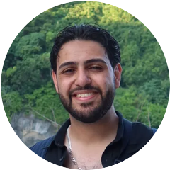
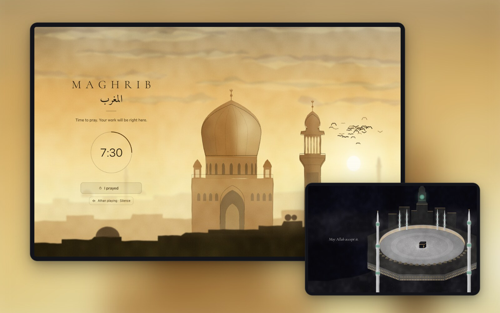
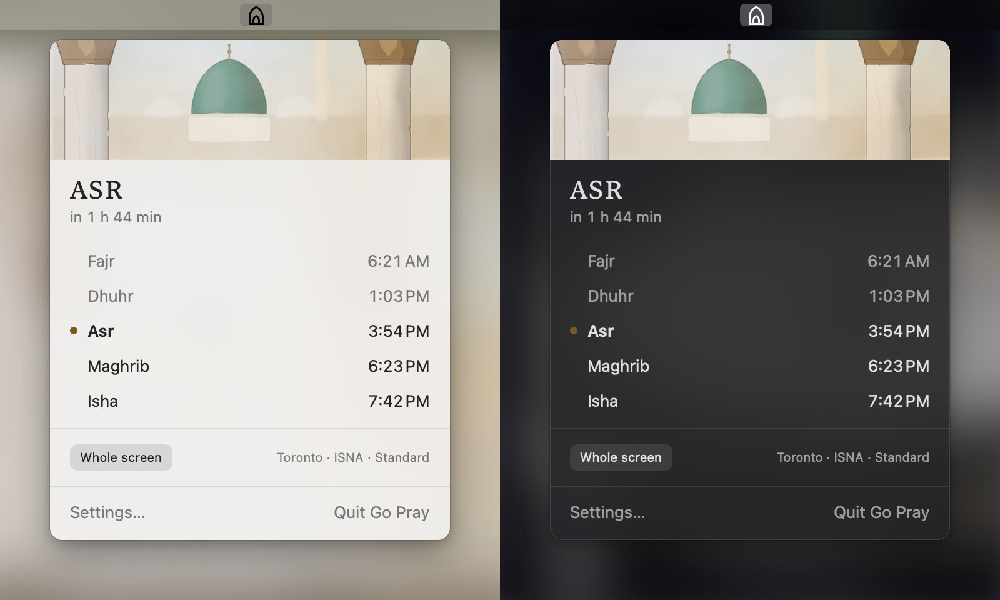
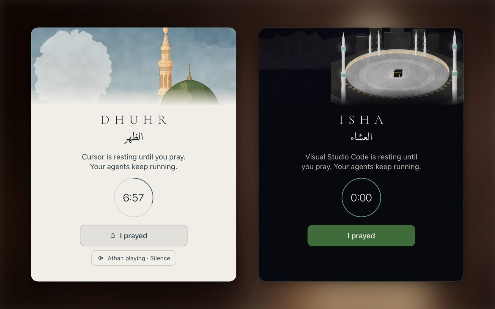
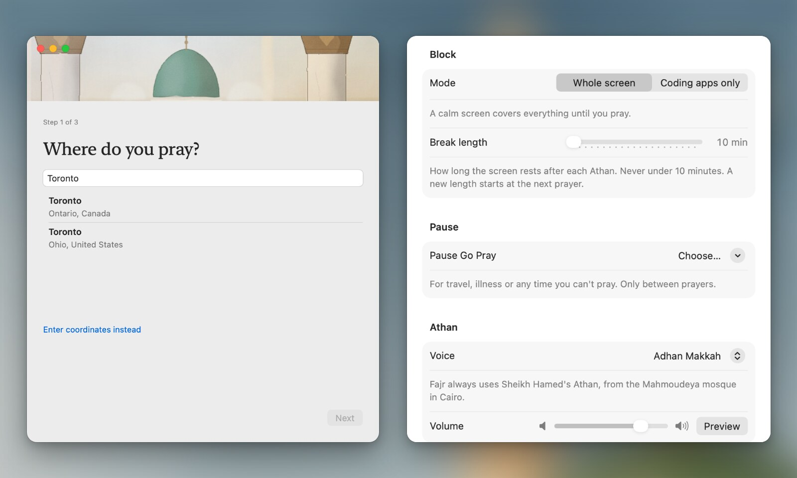

<p align="center">
  
</p>

<h1 align="center">GO PRAY</h1>

<h3 align="center" dir="rtl">قوم صلّي</h3>
<p align="center"><em>Oum Saly — "get up and pray", the way Egyptians say it</em></p>

<p align="center">
  A small Mac menu bar app that stops your work at every Athan<br>
  and lets you back after a real break.
</p>

<p align="center">
  <a href="https://github.com/simkinselgazar-rgb/go-pray/releases/latest"></a>
  
  
  
  <a href="LICENSE"></a>
  
</p>

<p align="center">
  <a href="https://github.com/simkinselgazar-rgb/go-pray/releases/download/v0.3.0/GoPray.dmg"></a>
  <a href="https://github.com/simkinselgazar-rgb/go-pray/releases/download/win-v0.3.0/GoPray-Setup.exe"></a>
</p>

<p align="center"><code>brew install simkinselgazar-rgb/tap/go-pray</code></p>

> [!NOTE]
> **Beta.** Family and friends are testing Go Pray now. If something goes wrong, please [open an issue](https://github.com/simkinselgazar-rgb/go-pray/issues).

### A note from the creator



> I made this app because I have been having a hard time keeping up with my prayers because of how busy I have been with building and working a corporate job. I hope that it can help you on your journey of getting closer with Allah as it is helping me. May Allah guide us all, and good luck on your journey, Brother/Sister.
>
> — Ahmed Elgazar

<br clear="left">

<p align="center">
  <a href="https://www.instagram.com/ahmedelgazarai/"></a>
  <a href="https://www.tiktok.com/@ahmedelgazarai"></a>
  <a href="https://www.youtube.com/@ahmedelgazarai"></a>
</p>

<p align="center">
  
</p>

When the Athan comes in, Go Pray plays it and covers the screen with a painting of that prayer's sky. A ring counts down your break. When the ring is full, you press **I prayed**, you see "May Allah accept it.", and your work is right where you left it.

Free and open source. No account, no tracking.

## New in 0.3

- **The Athan on your TV.** Go Pray can play the Athan on a Roku TV in your home. At each prayer your Mac opens the Go Pray Roku app, which shows that prayer's painting and plays the Athan through the TV, then goes back to the Roku home screen by itself. Add your TV in Settings → TVs (your Mac asks once to use your local network). The Roku app, "Go Pray: Athan & Adhan", is on its way to the Roku Channel Store. Several computers in one home are fine: the TV plays each prayer once. It works on Windows too: add your TV in Go Pray's Settings → TVs on your PC.

## New in 0.2

- **Choose your blocked apps.** In Settings → Blocked apps, switch off any default app or add your own. Changes only happen between prayers.
- **Emergency exits.** Five a year, for real emergencies: press and hold, then confirm. That prayer is recorded as skipped, not prayed. You can turn exits off completely in Settings.
- **Updates.** Go Pray checks GitHub once a day and tells you when a new version is out. The download is checked for the developer's signature before it opens. You can turn this off.

## A look around

### At the Athan

<p align="center">
  
</p>

Each of the five prayers has its own scene, painted in code. The ring shows how long is left. **I prayed** stays locked until the break is over. **Silence** stops the sound, never the break. Then: "May Allah accept it.", and you are back.

### In the menu bar

<p align="center">
  
</p>

A small mihrab in the menu bar. Click it for today's five times and how long until the next one.

### Coding apps only

<p align="center">
  
</p>

Would rather keep calls, music and notes open? Coding-apps mode hides your editors, terminals, AI apps and browsers instead of covering the whole screen. They are hidden, not quit, so your agents keep running.

### Your video pauses at the Athan

Whatever is playing (a YouTube video, Spotify, Music) pauses the moment the Athan starts, so you only hear the Athan. Go Pray never plays it again for you.

### Setup and settings

<p align="center">
  
</p>

Three questions on first launch: your city, how your times are worked out, and how Go Pray should stop you. Later, in Settings: a longer break (10 to 30 minutes), Pause for travel or illness, and the Athan voice.

## Install

**DMG:** download the latest `GoPray-<version>.dmg` from [Releases](https://github.com/simkinselgazar-rgb/go-pray/releases), open it, and drag **Go Pray** to Applications.

**Homebrew:**

```sh
brew install simkinselgazar-rgb/tap/go-pray
```

Needs macOS 14 (Sonoma) or later.

**Windows:** download [GoPray-Setup.exe](https://github.com/simkinselgazar-rgb/go-pray/releases/download/win-v0.3.0/GoPray-Setup.exe) and run it. No admin password needed. It is signed by Ahmed Elgazar; for the first few days Windows SmartScreen may still show a note, so click **More info → Run anyway**. Needs Windows 10 (1809) or later, 64-bit. Source: the [`windows/`](windows/) folder.

On first launch Go Pray asks three things: your city, how your prayer times are worked out (method and Asr), and how it should stop you. macOS then shows a note that Go Pray can run in the background. That is expected: it keeps the Athan on time after a restart.

## How it works

- **Prayer times are worked out on your Mac** from your city, with the [Adhan](https://github.com/batoulapps/adhan-swift) library. Go Pray only uses the internet when you search for your city.
- **At the Athan**, Go Pray plays the Athan and starts the break. Fajr has its own Athan.
- **Two ways to stop you:**
  - **Whole screen** (the default): every display is covered until you have prayed.
  - **Coding apps only**: your editors, terminals, AI apps and browsers are hidden, not quit. Anything running in them keeps running. Open one during the break and it is hidden again. Everything else (calls, music, notes) stays usable.
- **The break is 10 minutes** by default. You can make it longer (up to 30) in Settings, never shorter. A closed lid counts toward the break.
- **Other media pauses** the moment the Athan starts (a video, Spotify, Music: whatever macOS lists as Now Playing). Go Pray never resumes it for you. Calls are not Now Playing, so they should be left alone.
- **Silence** stops the Athan sound (for when you're out in public). It never ends the break.
- **Pause** (1 day, 3 days, a week, or until you resume) is for travel, illness, or any time you can't pray.
- **The menu bar icon** (a small mihrab) shows today's five times and how long until the next one.

## The rules

### No escape by reflex

Once the break starts, the only way out is **I prayed**, and it only unlocks when the break is over. Quitting Go Pray, switching mode and changing settings are all refused during a break. In whole-screen mode, Cmd-Tab and the Dock are off until you have prayed; in coding-apps mode, a hidden app you reopen is hidden again. Settings and Pause can only be changed between prayers, and a change never shortens the break that is running.

There is no snooze and no unlock code. That is on purpose.

With **Launch at login** on (the default), macOS runs Go Pray in the background and starts it again if it crashes or is force-quit, and the break picks up where it was. With Launch at login **off**, that is your choice: Go Pray runs only while you have it open, and if it is closed or crashes, nothing restarts it until you open it again.

### Never trapped

Go Pray must never lock you out for longer than one break. When something goes wrong, it lets you go:

- **Crash loop:** if Go Pray crashes 3 times within 2 minutes while the screen is covered, it gives up that one prayer's break. The next prayer works as normal.
- **Broken state file:** if its saved state is damaged or makes no sense (dates in the future, for example), it sets the file aside and starts fresh, with no break.
- **Clock changes:** if your clock jumps backwards, the button unlocks rather than making you wait longer. A break is never longer than its set length from any moment.
- **The painting fails to load:** a plain cover with the same countdown and the same button takes its place within 4 seconds.
- **No valid prayer times** (a bad city, for example): no Athan, no break. The menu asks you to check your city.
- **Missed window:** if your Mac was asleep for a whole prayer window, that prayer is not blocked afterwards. If you wake it while a prayer's window is still open, the break starts then.
- **A new Athan during a break** replaces the old break. Breaks never stack.

You can always lock the screen, log out, shut down or switch user. Go Pray never blocks those.

### For yourself only

Go Pray is a tool you choose for yourself. Installing it on someone else's Mac without their agreement is misuse. It is always visible (menu bar icon, Login Items) and can be quit whenever no break is running.

### Why not the App Store

Go Pray is not sandboxed (it has to hide other apps), and pausing your media uses Apple's private MediaRemote framework. The Mac App Store would reject both, so Go Pray ships only as a notarized DMG and a Homebrew cask. If macOS ever removes that framework, the pause quietly does nothing and the Athan still plays. The code is one file, `GoPray/Audio/MediaPauser.swift`.

## Remove it

Quit Go Pray from its menu (between prayers), then delete it from Applications. With Homebrew: `brew uninstall --cask go-pray`. To stop the background item by hand:

```sh
launchctl bootout gui/$(id -u)/com.ahmedelgazar.gopray.agent
```

## Contributing and reporting a problem

Found a bug, a wrong prayer time, or a rough edge? Please [open an issue](https://github.com/simkinselgazar-rgb/go-pray/issues) and say your city, your method and what you saw. Pull requests are welcome; see [Building from source](#building-from-source).

## Credits

- **Athan recordings:** the PrayTimes.org collection, and Sheikh Hamed of the Mahmoudeya mosque, Cairo, for Fajr. Full credits are in the app (Settings, Credits) and in [`audio/LICENSES.md`](audio/LICENSES.md).
- **Fonts:** Cormorant Garamond and Amiri, under the SIL Open Font License (the licence files sit next to the fonts).
- **Prayer times:** [adhan-swift](https://github.com/batoulapps/adhan-swift) by Batoul Apps (MIT).

**If you own one of these recordings and want it removed, email hello@simkinselgazar.com and we'll take it out.**

## Licence

The code is MIT (see [`LICENSE`](LICENSE)). The audio and fonts are **not** covered by the MIT licence; each keeps its own terms, listed in [`audio/LICENSES.md`](audio/LICENSES.md) and beside the font files.

## Building from source

```sh
brew install xcodegen
xcodegen generate
xcodebuild -project GoPray.xcodeproj -scheme GoPray -configuration Debug build
```

Debug builds have a small debug section in the menu for testing ("Trigger Athan now", with a 20-second break). Release builds contain none of it: `scripts/guard.sh --release "<path>/Go Pray.app"` checks the binary.

**Before every release, test an upgrade in place.** Install the previous version with Launch at login on, then `brew upgrade` (and, separately, replace the .app by hand). The login agent must come back cleanly: `launchctl print gui/$(id -u)/com.ahmedelgazar.gopray.agent` shows it running from the new bundle, with no `EX_CONFIG` spawn loop, and `kill -9` of the app relaunches it. macOS Background Items checks the app's executable, and a rebuilt debug app at the same path was refused until it was registered again. At launch (`AppDelegate.wire()`, decided by `SingleInstance.shouldRepairAgent`) Go Pray re-registers the agent when it wanted launch at login but macOS lost the registration (`.notFound` / `.notRegistered`); it leaves `.requiresApproval` alone, because that means the person turned it off in System Settings.
